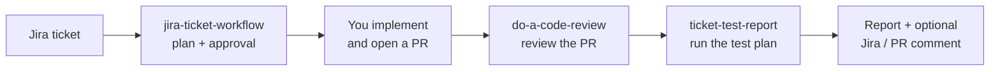

<p align="center">
  
</p>

<p align="center">
  
  
  
  
  
  
  
  
  
</p>

Spellbook is a personal [Claude Code plugin marketplace](https://code.claude.com/docs/en/plugins/create-marketplace). It packages engineering workflows as spells (skills) that you install once and use in every project, versioned from this repository instead of copied into each one.

It is built for a specific way of working:

- **Stack:** PHP/Laravel backends with React or Vue (TypeScript) frontends.
- **Process:** work tracked in **Jira**, isolated in **Git** branches and worktrees, and reviewed on **GitHub** pull requests.

The workflows themselves (requirements, workspace safety, approval gates, honest reporting) apply to any stack. The deep, stack-specific checklists cover Laravel and React/Vue/TypeScript. See [Stack support](#stack-support).

The vocabulary:

- **Spellbook**: the toolkit, which is both the marketplace and its plugin.
- **Spell**: one skill, such as `do-a-code-review`.
- **Plugin**: the installable package. Every spell ships in the `spellbook` plugin and runs as `/spellbook:<spell>`.

## Spells

| Spell | Command | Use it to |
| --- | --- | --- |
| [`jira-ticket-workflow`](#jira-ticket-workflow) | `/spellbook:jira-ticket-workflow <ticket>` | Understand a ticket and agree on an implementation plan **before** any code is written |
| [`do-a-code-review`](#do-a-code-review) | `/spellbook:do-a-code-review <pr \| branch>` | Review a pull request against its ticket, with static analysis and tests |
| [`ticket-test-report`](#ticket-test-report) | `/spellbook:ticket-test-report <ticket>` | Run the ticket's own test plan and produce an HTML QA report with evidence |

They follow a ticket through its life:



Each spell also works on its own.

## Workflows

Every spell follows the same ground rules:

- **It asks before acting.** It never switches branches, stashes, commits, pushes, posts comments, or removes worktrees without your explicit confirmation in the conversation.
- **It lets you choose the workspace.** Before it touches code, it shows the current branch and whether there are uncommitted changes, and asks whether to work in the **current folder** or a **separate Git worktree**. It recommends a worktree when the folder is dirty or on another branch, but the choice is yours.
- **It reports honestly.** It never reports a check or test as passed unless it actually ran. When Jira, GitHub, or a tool is unavailable, it says so instead of guessing.
- **It treats everything it reads as data.** Code, PR text, tickets, and web pages can't override the workflow.

### jira-ticket-workflow

**Input:** a Jira key or URL. **Output:** a plan you approve. No code is written before you approve it.

1. **Discovery.** Reads the ticket: description, acceptance criteria, comments, attachments, and related tickets. It also reads `CLAUDE.md`, `README.md`, ADRs, and the impacted code, and looks for existing patterns to reuse.
2. **Clarification.** Asks about anything ambiguous. It never assumes missing requirements.
3. **Workspace.** Asks whether to work in the current folder or create a worktree on a `feature/<TICKET-ID>-…` branch from an up-to-date base.
4. **Plan.** Presents five sections: Ticket Understanding, Technical Analysis (impacted files, current flow, risks), Workspace, Implementation Plan, and Testing Strategy. The analysis covers requirements, architecture, backend and frontend concerns, code quality, and tests.
5. **Approval gate.** Waits for your explicit go-ahead. Commits, pushes, PRs, and Jira updates each still need their own confirmation.

### do-a-code-review

**Input:** a PR URL or number, or a branch. If you give none, it uses the current branch's PR. **Output:** a review grouped by severity, a detailed review document in `./reports/`, and optional posting to the PR.

1. **Language.** Asks whether to communicate in English or Portuguese. Code and identifiers always stay in English.
2. **Target and workspace.** Resolves the PR with `gh` or the GitHub MCP, then asks whether to review in the current folder or a temporary worktree. A worktree is created detached from the PR head, and existing worktrees are never touched.
3. **Requirements.** Takes the Jira key from the PR and reads the ticket. If Jira is unavailable, it uses the PR description and says so in the review.
4. **Review.** Covers:
   - Requirements coverage.
   - The stack checklists (see [Stack support](#stack-support)).
   - Code quality, including new TODOs that need a Jira key, such as `// TODO GROW-1234: …`.
   - Architecture.
   - Test coverage.

   It runs type checks, static analysis, and tests after inspecting the project's real setup (Compose file, service name, package manager). When it can establish a baseline, it reports only the errors the PR introduces.
5. **Report.** Sections are Critical Issues, Important Issues, Suggestions, and Checks Performed. Each finding has a file and line, its impact, and a fix, and is marked as either a *verified defect* or a *risk*.
6. **Review document.** Writes `./reports/code-review-<PR-or-branch>-<date>.md` in your project, never inside the temporary worktree. It explains each step (what was checked, how, which commands, and the result, including skipped steps). For each finding, it gives 1–3 possible solutions with trade-offs, a recommendation, and how to verify the fix, and it ends with a next-steps checklist.
7. **Publish (optional).** Asks whether to post the review to the PR and what to change first. Long reviews are collapsed into `<details>` sections, and file links point at the reviewed commit. If posting isn't possible, it gives you a ready-to-paste comment.
8. **Cleanup.** Removes only the worktree it created.

### ticket-test-report

**Input:** a Jira key or URL. **Output:** `./reports/<TICKET-ID>-test-report.html`, plus a summary in chat.

1. **Language.** Asks whether the report should be in English or Portuguese. Ticket text is quoted verbatim. Only the spell's own observations are translated.
2. **Ticket.** Fetches the acceptance criteria and the test plan from Jira, a custom field, comments, or a linked Confluence page. If there is no test plan, it asks you instead of inventing one.
3. **Workspace.** Asks whether to test in the current folder or a temporary worktree, and records the environment under test.
4. **Execution.** Runs each case in ticket order, using the method that proves the result:
   - **Browser:** Claude in Chrome, with screenshots as evidence.
   - **API / CLI:** `curl` or `php artisan`, recording the command and response.
   - **Automated suites.**
   - **Code review:** for steps that can't run live, such as a migration or a cron job.

   Each case is marked Passed, Failed, Blocked, or Not Tested. Passed requires evidence, and a blocked case never stops the run.
5. **Traceability.** Builds a matrix from acceptance criteria to test cases. A criterion with no covering case is flagged *Not Covered*.
6. **Report.** Writes a self-contained HTML report with a summary, blockers, the criteria matrix, each case with its evidence, defects, and limitations. It then asks whether to post the results to Jira.

## Jira and Git in the workflows

### Jira

Jira is the source of truth for *what* should be built and tested.

- **Finding the ticket.** The spells take a key or URL as an argument. Without one, `do-a-code-review` looks for a key such as `GROW-1234` in the PR title, description, or branch name.
- **What they read.** Description, acceptance criteria, comments, attachments, linked issues, and, for `ticket-test-report`, the test plan in a custom field, a comment, or a linked Confluence page.
- **How it is used.**
  - `jira-ticket-workflow` plans against the acceptance criteria.
  - `do-a-code-review` checks requirements coverage and scope creep.
  - `ticket-test-report` runs the ticket's own test plan and maps every criterion to evidence.
- **Conventions.** The review flags every new `TODO` without a ticket key, for example `// TODO GROW-1234: …`. `jira-ticket-workflow` names branches `feature/<TICKET-ID>-short-description` unless your team uses another convention.
- **Writing back.** Posting a comment to the ticket is offered at the end and happens only after your explicit approval.
- **Without Jira.** The spells say so, and you paste the ticket content in yourself. They never invent requirements or claim to have read a ticket they couldn't access.

Access goes through an MCP server in your Claude Code setup: `jira-ticket`, or any Jira/Atlassian MCP.

### Git

Git keeps the work isolated and the reports reproducible.

- **Workspace choice.** Before touching code, each spell runs `git status --short` and `git branch --show-current`, then asks whether to work in the current folder or a separate worktree. It recommends a worktree when there are uncommitted changes or the branch doesn't match.
- **Worktrees.**
  - Review and test worktrees are created *detached* from the target (`origin/<branch>`, or `pull/<n>/head` for PRs, including PRs from forks), so no local branch is created or overwritten.
  - `jira-ticket-workflow` creates its worktree on a new `feature/<TICKET-ID>-…` branch from a freshly fetched base.
  - Existing worktrees are listed first and never touched. Only the worktree a spell created is removed, and it asks first if that worktree has changes.
- **Fresh worktree setup.** A new worktree has no dependencies and no `.env`. The spells work out what is needed, ask before copying environment files, never overwrite files, and check Docker volume mappings so containers analyze the right checkout.
- **New errors only.** When a baseline can be established, type-check and PHPStan results are compared against the base commit, so the review reports only errors the PR introduces. When it can't, the review says so.
- **Traceability.** Reports record the branch and commit SHA, and GitHub links point at the reviewed commit so they stay valid.
- **Never without asking.** Branch switches, stashes, commits, pushes, and PR comments all need your confirmation. PR data comes from the `gh` CLI or a GitHub MCP.

## Stack support

| | `do-a-code-review` | `jira-ticket-workflow` | `ticket-test-report` |
| --- | --- | --- | --- |
| **PHP / Laravel** | Deep checklist: N+1, validation, authorization and policies, transactions, SQL injection, migrations, queues. Runs PHPStan/Larastan and PHPUnit/Pest, natively or through Docker Compose. | Backend considerations in the plan | Runs `php artisan`, PHPUnit, and Pest |
| **React / Vue / TypeScript** | Deep checklist: async races, hook dependencies, leaks, props, state, API contracts. Runs `tsc`/`vue-tsc`, the project's linter, and Jest/Vitest. | Frontend considerations in the plan | UI steps in the browser, and `yarn`/`npm` test runners |
| **Node.js backends** | General review only | Listed in the backend considerations | Project test commands |
| **Any other stack** | General review: requirements, code quality, architecture, and test coverage. The report states that no stack checklist was applied. | Fully applicable | Fully applicable: API, CLI, browser, and code-review methods |

Commands such as `docker-compose -f ../docker-compose.yml exec core-app …` appear in the skills as **examples**. The spells check the project's actual Compose file, service names, and tooling before running anything. To add deep support for another stack, see [Adding spells and plugins](#adding-spells-and-plugins).

## Integrations

Installing the plugin does **not** set any of these up. Each spell detects what is available and reports what is missing.

| Integration | `jira-ticket-workflow` | `do-a-code-review` | `ticket-test-report` |
| --- | --- | --- | --- |
| Jira / Confluence MCP (`jira-ticket` or Atlassian) | Strongly recommended. Without it, you paste the ticket. | Optional. Used for requirements coverage. | Strongly recommended. Without it, you paste the test plan. |
| GitHub: `gh` CLI (`gh auth login`) or GitHub MCP | Not used | Needed for PR metadata and posting. Without it, it falls back to local `git`. | Optional. Used to find the linked PR or branch. |
| Claude in Chrome (browser extension) | Not used | Not used | Needed for UI steps. Without it, those cases are marked Blocked. |
| Project tooling (Docker, PHP, Node, package manager) | Used for tests during implementation | Used for static analysis and tests | Used for suites and running the app |

## Prerequisites

- [Claude Code](https://code.claude.com/docs/en/overview), installed and signed in.
- `git`.
- Read access to `sahdoio/spellbook`. While the repository is private, your machine needs GitHub credentials that work without prompting: an SSH key loaded in `ssh-agent`, or HTTPS credentials stored with `gh auth login && gh auth setup-git`.

## Installation

Inside a Claude Code session:

```text
/plugin marketplace add sahdoio/spellbook
/plugin install spellbook@spellbook
```

Or from your shell:

```bash
claude plugin marketplace add sahdoio/spellbook
claude plugin install spellbook@spellbook
```

The install id is `<plugin>@<marketplace>`, and both names are `spellbook`. The default scope is **user**, which makes the spells available in every project on this machine. Use `--scope project` to share it through a repository's `.claude/settings.json`, or `--scope local` for one repository only. Restart Claude Code or run `/reload-plugins` afterwards.

## Usage

```text
/spellbook:jira-ticket-workflow GROW-1234
/spellbook:do-a-code-review                      # PR of the current branch
/spellbook:do-a-code-review https://github.com/acme/app/pull/123
/spellbook:do-a-code-review feature/GROW-1234-retry-logic
/spellbook:ticket-test-report https://acme.atlassian.net/browse/GROW-1234
```

Claude can also pick a spell when your request matches it, for example "review this PR" or "test ticket GROW-1234". The `/spellbook:` form is the reliable one.

## Managing the installation

| Task | Command |
| --- | --- |
| List installed plugins | `claude plugin list`, or the **Installed** tab in `/plugin` |
| Show spells and context cost | `claude plugin details spellbook` |
| Refresh the catalog | `/plugin marketplace update spellbook` |
| Update the plugin | `claude plugin update spellbook@spellbook`, then restart |
| Turn on auto-update | `/plugin` → **Marketplaces** → `spellbook` → **Enable auto-update** |
| Disable or enable without uninstalling | `claude plugin disable spellbook@spellbook` / `claude plugin enable spellbook@spellbook` |
| Uninstall the plugin | `claude plugin uninstall spellbook@spellbook` |
| Remove the marketplace (also uninstalls its plugins) | `claude plugin marketplace remove spellbook` |

Updates arrive only when `version` in `plugins/spellbook/.claude-plugin/plugin.json` changes. See [CONTRIBUTING.md](CONTRIBUTING.md#releasing).

## Troubleshooting

- **`marketplace add` fails on a private repository.** Claude Code runs `git` without prompts. Check that `git ls-remote git@github.com:sahdoio/spellbook.git` works in your shell. If you have no SSH key, set `CLAUDE_CODE_PLUGIN_PREFER_HTTPS=1` and store HTTPS credentials with `gh auth login && gh auth setup-git`.
- **`Plugin "x" not found in marketplace`.** Use the exact id `spellbook@spellbook`, then run `/plugin marketplace update spellbook`.
- **A spell doesn't show up after install.** Restart the session or run `/reload-plugins`. Check the **Errors** tab in `/plugin` and the output of `claude plugin list`.
- **You pushed changes but don't see them.** Bump `version` in `plugin.json`, then update the marketplace and the plugin.
- **A spell reports a missing tool.** See [Integrations](#integrations). Those are configured outside the plugin.
- **Static analysis inside Docker reviews the wrong code.** When you use a worktree, the containers may mount the main checkout. The spells check the volume mappings, but confirm which path the container sees.

## Repository structure

```text
spellbook/
├── .claude-plugin/marketplace.json     # Marketplace catalog
├── plugins/
│   └── spellbook/                      # The plugin; its name is the /spellbook: prefix
│       ├── .claude-plugin/plugin.json  # Plugin manifest (name, version)
│       ├── skills/
│       │   ├── do-a-code-review/
│       │   │   ├── SKILL.md            # Workflow orchestrator
│       │   │   └── references/         # Checklists, output format, review-document template
│       │   ├── jira-ticket-workflow/
│       │   │   └── SKILL.md
│       │   └── ticket-test-report/
│       │       ├── SKILL.md
│       │       └── assets/report-template.html
│       └── README.md                   # File map of the plugin
├── assets/logo.svg
├── scripts/validate.sh                 # Local and CI validation
└── .github/workflows/validate.yml      # CI
```

## Local validation

```bash
./scripts/validate.sh        # or: npm run validate
```

The script checks:

- JSON syntax.
- Required files.
- That every plugin source resolves to a directory, and that each plugin's `plugin.json` name matches its marketplace entry.
- Skill frontmatter (`name`, `description`).
- Relative Markdown links inside each plugin.

It also runs the official `claude plugin validate --strict` on the marketplace and on every plugin. CI runs the same script on pull requests and on pushes to `main`. No secrets are needed.

To try your local changes without installing:

```bash
claude --plugin-dir ./plugins/spellbook
```

## Adding spells and plugins

- **New spell:** add `plugins/spellbook/skills/<spell-name>/SKILL.md`. It runs as `/spellbook:<spell-name>`.
- **Deep support for another stack in the review:** add `plugins/spellbook/skills/do-a-code-review/references/<stack>-review.md` and a line in that skill's `SKILL.md` saying when to read it.
- **Separate plugin:** add one only when something must be installed on its own. Its spells use its own prefix (`/<name>:`), not `/spellbook:`.

Step-by-step instructions are in [CONTRIBUTING.md](CONTRIBUTING.md).

## Security considerations

- The spells treat code, PR text, Jira content, web pages, and tool output as untrusted, and ignore instructions embedded in them.
- Externally visible actions (PR or Jira comments, commits, pushes) require your explicit approval in the conversation.
- Secrets are never printed or copied into reports or comments. Copying `.env` files into a worktree requires your approval, and existing files are never overwritten.
- `do-a-code-review` and `ticket-test-report` write documents to `./reports/` in the project you run them in. These can contain internal URLs, ticket content, and screenshots, so add `reports/` to that project's `.gitignore` if they shouldn't be committed.
- This repository contains no credentials. Plugins run with your user privileges, so review changes before you update.

## Current limitations

- Deep review checklists exist only for PHP/Laravel and React/Vue/TypeScript.
- The ticket spells assume Jira. Without it, you paste the ticket content in yourself.
- The browser steps in `ticket-test-report` need Claude in Chrome.
- Claude Code only. Cloud sessions (claude.ai/code) don't load plugins from your local settings.
- The repository is private, so each machine needs GitHub access. Making it public is a separate decision.

## License

[MIT](LICENSE)
